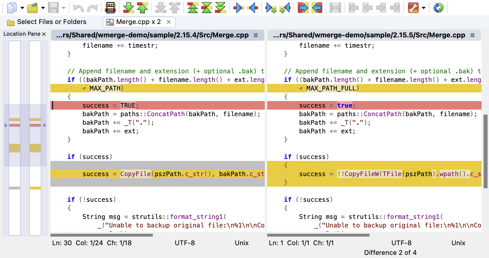
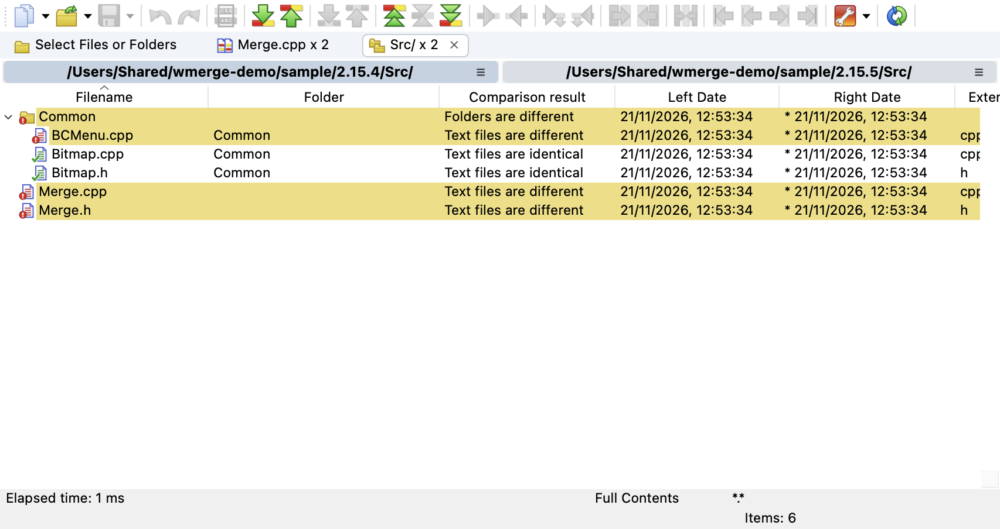
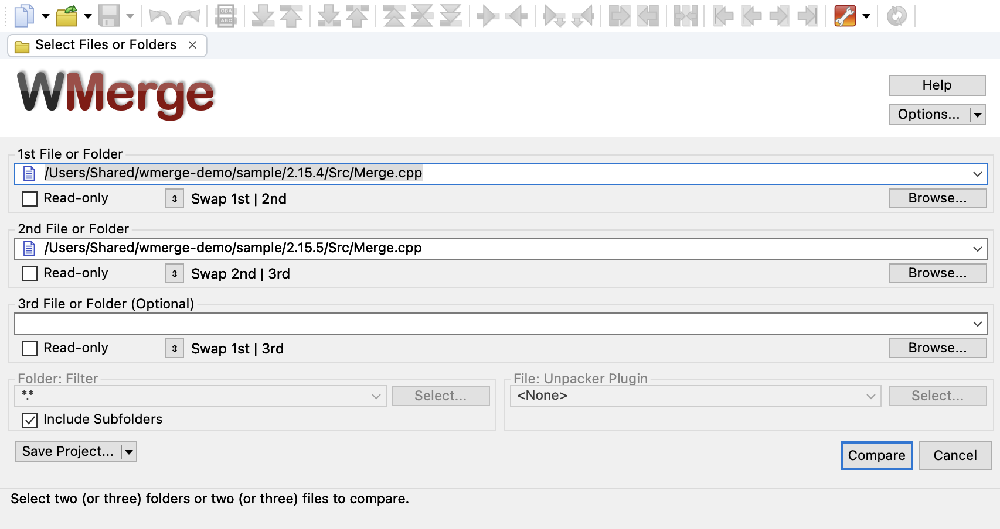

# WMerge

Compare and merge files and folders on macOS, in the spirit of WinMerge on Windows: two panes side
by side, differences in yellow, the selected one in red, and one keystroke to copy a difference to
the other side.

> **Windows-style utilities for macOS** — one set, each works on its own:  
> [WExplorer](https://github.com/opewix/wexplorer) — file manager  
> [WTaskbar](https://github.com/opewix/wtaskbar) — taskbar and Start menu instead of the Dock  
> [WPhoto](https://github.com/opewix/wphoto) — picture viewer  
> [WTortoise](https://github.com/opewix/wtortoise) — Git in the right-click menu, like TortoiseGit  
> **WMerge** — file and folder compare, like WinMerge







## Features

- **File compare:** two editable panes that scroll together, filler lines where one side has no
  counterpart, the changed part of each line highlighted, syntax coloring, a location pane with the
  whole file at a glance and an optional pane showing only the current difference.
- **Merge:** *Copy to Right / Left*, *Copy and Advance*, *Copy All*; jump to the next, previous,
  first or last difference. Double-click a difference to select it.
- **Editing:** type right in either pane, with undo and redo, find and replace (regular
  expressions too), go to a line or a difference. The comparison updates as you type.
- **Folder compare:** tree or flat list with the columns of WinMerge, row colors and status icons,
  filters for identical, different and one-side-only items, file masks (`*.cpp;*.h;!*.obj`).
  Double-click a file to compare it; copy items to the other side or move them to the Trash.
- **Compare options:** whitespace (compare, ignore changes, ignore all), blank lines, case and
  line endings.
- **Files stay as they were:** encoding (UTF-8 with or without BOM, UTF-16, Windows-1251/1252) and
  line endings — even mixed ones — are kept on save.
- *Tools → Generate Patch* writes the differences as a unified diff.

## Keys

WinMerge shortcuts, with ⌘ for Ctrl and ⌥ for Alt:

| | |
|---|---|
| `⌥↓` / `⌥↑`, `F8` / `F7` | next / previous difference |
| `⌥Home` / `⌥End` / `⌥↩` | first / last / current difference |
| `⌥→` / `⌥←` | copy to right / left |
| `⌘⌥→` / `⌘⌥←` | copy and advance |
| `F5` | refresh |
| `F4` | select the difference in the current line |
| `F6` | switch pane |
| `⌘S`, `⌘Z`, `⌘Y`, `⌘F`, `F3`, `⌘G` | save, undo, redo, find, find next, go to |

## Install

1. Download `wmerge-<version>.dmg` from [Releases](https://github.com/opewix/wmerge/releases).
2. Open it and drag **WMerge** to **Applications**.
3. The app is not notarized by Apple, so macOS blocks the first launch. Open it once, then go to
   **System Settings → Privacy & Security** and click **Open Anyway**. Or run:

   ```sh
   xattr -dr com.apple.quarantine /Applications/WMerge.app
   ```

Requires macOS 14 Sonoma or later.

## Command line

```sh
/Applications/WMerge.app/Contents/MacOS/WMerge left.txt right.txt   # two files
/Applications/WMerge.app/Contents/MacOS/WMerge dir1 dir2            # two folders
```

Other apps open a comparison with a link: `wmerge://compare?path=<left>&path=<right>`. Optional
`title=<text>` items, in the same order, replace the paths in the pane headers. A file that cannot
be written opens read-only. [WTortoise](https://github.com/opewix/wtortoise) uses this for its diffs
when *Use WMerge to compare files* is on in its Settings.

## Build from source

Only the Swift toolchain is needed (Xcode Command Line Tools), no Xcode project.

```sh
swift build                               # debug build
./scripts/bundle.sh                       # build/WMerge.app
VERSION=0.1 ./scripts/make-dmg.sh         # build/wmerge-0.1.dmg
.build/debug/WMerge -selftest             # check the diff and merge engine
.build/debug/WMerge -snapshot <dir>       # render the windows to PNG
```

## Not there yet

Three-way compare, binary / image / table compare, moved-block detection, plugins, project files,
line filters and `.flt` filter files, reports.

## License

[MIT](LICENSE). Free to use, modify and distribute; provided as is, without any warranty.

## Disclaimer

WMerge is an independent project, not affiliated with or endorsed by the WinMerge project,
Microsoft or Apple. It ships no WinMerge code or artwork: the diff engine is its own and all
graphics are drawn by the app itself.
